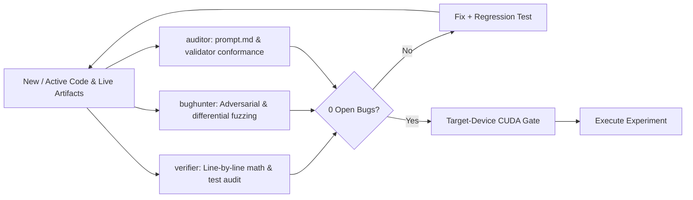

# Pre-Experiment & Periodic Parallel Bug-Check Protocol

> [!IMPORTANT]
> **Hard Rule (persisted in [AGENTS.md](file:///home/catid/drafter/AGENTS.md))**:
> 1. **Never run any experiment, benchmark, training job, or evaluation on unverified code.** Every branch, launch command, and validator update must pass parallel independent review (`verifier` + `bughunter` + `bugfinder` + `auditor`) PLUS a target-device CUDA sanity/parity gate (`0` open bugs) *before* launching GPU runs.
> 2. **Run periodic bug checks & swarm value-add sweeps (`*/20 * * * *` recurring cron)**: Every 20 minutes, (a) audit roster/processes/GPUs to eliminate serial handoff idle gaps, catch stuck processes early, and queue ahead-of-time optimizations/validators for upcoming phases, and (b) ensure at least one dedicated bug-hunting agent (`bugfinder`, `bughunter`, `verifier`, or `auditor`) is actively checking active branches, launch scripts, validators, or live experiment checkpoints/outputs. *(Note: commit the expanded swarm-effectiveness bullet into [AGENTS.md](file:///home/catid/drafter/AGENTS.md) right after `PID 1867881` finishes so `runtime.py`'s `git_dirty` provenance check stays `False` during live 8-GPU execution.)*

---

## Parallel Bug-Check Architecture

---

## Bug-Check Ledger

| Round | Target Branch / Pipeline | Parallel Checkers | Bugs Caught & Fixed *Before* GPU Execution | Status |
|---|---|---|---|---|
| **R1–R3 Fastpaths** | `opt/pytorch-fastpaths` (`256abcd`) | `verifier`, `bughunter` | `REPRO-1` FP64 tie guard, `OPT-BUG-1..7`, `OPT-R2-BUG-1..4`, `OPT-R3-BUG-1..3` (`OnlineBigram` stale `row_slot`, `top_p` sort/scatter 0-ULP parity, `T=0` `torch.max` lowest-ID) | **Signed off (`0` open)** |
| **M5 & Full Scale** | `feat/m5-and-full-scale` (`0e60046`) | `verifier`, `bughunter` | `M5-R2-BUG-1..3` (`_TritonRowwiseKLFunction` `.is_inference()` clone & `-inf` tile guards, `SignedHash` autograd bypass, checkpoint scale provenance) | **Signed off (`0` open)** |
| **Post-M4 Integration P1** | `feat/post-m4-integrated` (`99a8bb64`) | `verifier`, `bughunter`, `auditor` | `INT-BUG-1..9` (`diagnostic_<scale>.json` wiring, 11-arm fixed-`beta=1.0` scaled eval, read-only `artifacts_root` isolation, `bf16_gemm` train+eval propagation, `long_*` `repetition_dominated` primary exclusion) | **Signed off (`0` open)** |
| **8-GPU M4 Timing** | `feat/m4-8gpu-timing` (`dfe72a0`) | `verifier`, `bughunter`, `auditor` | Verified `10/10` `09a5469` algorithm lock, NUMA `16`-core disjoint pinning, `CUDA_VISIBLE_DEVICES=0` calibration env requirement, 8-process sharding lock safety + real-B300 CUDA pre-launch gate | **Signed off & Live on 8 GPUs (`0` open)** |
| **Post-M4 Integration P2** | `feat/post-m4-integrated` (`116d7b1f`) | `verifier`, `bughunter`, `auditor` | `INT-BUG-10..16` (zero parent CUDA context across subprocesses, 8-GPU snake-sharded `fastpath_bench`, `32GB` DuckDB `stats_memory_limit` in `TRANSIENT_CONFIG_KEYS`, `m5_exact_pairs` `freeze_new` overflow policy, non-zero `--gpus` child `cuda:0` mapping) | **Signed off (`0` open)** |
| **Round-4 Online Turbo** | `opt/round4-online-turbo` (`4b55178d`) | `verifier`, `bughunter`, `auditor` | Core CoW `LazySignedHash` + analytic `live_full` backward passed all 4 fuzz batteries (`0` math/sync bugs); caught & fixed `R4-BUG-1` (`dfe72a0` harness hash in post-Gate-E `validate.py`), `R4-BUG-1b` (`git show` clone fallback), `R4-BUG-2` (`state_bytes_estimate` setter flush), `R4-BUG-3` (`fastpath_bench` resume schema) | **Signed off (`0` open, `454 passed`)** |
| **Periodic Live Gate-E Prep** | Live 8-GPU `m4_timing` + `m4_sharded_timing_driver.py` + `build_and_audit_reports.py` | `verifier`, `bughunter`, `auditor` | Caught & fixed `REPORT-BUG-1..2`; Gate E completed with **`64,141,807` M3+M4 validator checks (`0` failures)** and `±0.51%` 8-GPU vs 1-GPU calibration parity on `standard_nonthinking` | **Gate E Passed (`0` open)** |
| **Round-5 M5 Lookahead & Tune Turbo** | `feat/post-m4-integrated` (`fa77bc45`) | `verifier`, `bughunter`, `auditor` | `7.58×` batched `_CandidateLookaheadCache`, 8-GPU sharded `--stage m5 --mode tune`, threaded shard prefetching; caught & fixed `R5-BUG-1` (`frozen_settings_hash` resume invariance), `R5-BUG-2` (`support`/`clamped` mutation fallback), `R5-BUG-3` (bounded `ThreadPoolExecutor` teardown) | **Signed off (`0` open, `492` tests)** |
| **Phase-2 Real-B300 CUDA Gate** | `opt/round4-online-turbo` (`2fcc3e65`) | `turbo` (`GPU 0`), `bughunter` (`GPUs 1,3`), `verifier` (`GPU 2`) | Caught & fixed all **5 real-B300 hardware bugs** (`CUDA-BUG-1..5`): `StaticGraphCallable` initial `graph.replay()`, `OnlineBigram` BF16 `log`, `30+` `aten::index.Tensor` stream syncs -> `.gather`/`index_select`, `bf16_gemm` `g_dA` FP32 accum, and `NCCL_NVLS_ENABLE=0` on B300; verified **`15 / 15` gate suites + `154 / 154` adversarial B300 checks (`33.38×` B300 `rerelax` speedup)** | **Signed off (`0` open) & Merged (`5f0a5407`)** |
| **Periodic Live Post-M4 Sweep #1** | Live 8-GPU `post_m4_suite_driver.py` (`5f0a5407`) + `audit_post_m4_suite.py` | `verifier`, `bughunter`, `auditor` (in parallel) | Audited all 5 chained steps + 14 child CLI schemas (`0` unknown flags), verified bit-identical Step-5 `--suite all` cache-hit (`119.8 ms`, `0` spawns), built & verified `audit_post_m4_suite.py` (`24/24` fault-injection tests passed), confirmed `28/28` M0–M4 artifacts byte-intact | **Passed (`0` open); 8 GPUs active** |
| **Pre-Relaunch 2-GPU B300 NCCL & Train-Turbo Gate** | `opt/round4-online-turbo` (`391b16de`) + `audit_post_m4_suite.py` | `auditor` (`#215`), `bugfinder` (`#217`, `GPUs 6,7`), `verifier` (`#218`, `GPUs 4,5`), `bughunter` (`#219`, `GPUs 2,3`) | Caught & fixed `TRAIN-NCCL-BUG-1` (`_comm_device` & `broadcast_object_list`), `CUDA-BUG-6b` (`60m` NCCL timeout), `LAUNCH-CLI-BUG-1` & `SUITE-ATTR-BUG-1` (`#205`), `_HEAD_CAST_LOCK` `RLock` (`#210`), `AUDIT-REP-BUG-1` (`#212`), and `3.15–3.44×` `TRAIN-PERF-1` (`0-ULP` Qwen3 head parity + 1-GPU==2-GPU `nccl` across all objectives/backends/uneven-empty-ranks/resume) | **Quad-Signed Off (`0` open) — Live on 8 GPUs (`PID 1867881`)** |
| **20m Sweep #1 (Wave-2 Phase-B Pre-Audit + Live Stage-2 Check)** | Phase-B `feat/phase-b-full-scale` (`0afc795d`) + live `m2_refit_ws_2c7b2ed9dfa2` (`dense_sparse` `5,461/10,539`) | `verifier` (`#228`), `bughunter` (`#229`), `bugfinder` (`#234`), `auditor` (`#236`) | `verifier` passed `2,816/2,816` differential checks; `bughunter` & `bugfinder` caught 5 Phase-B bugs (`IO-BUG-1`, `IO-BUG-2`, `EVAL-BUG-3`, `PHASE-B-RELPATH-BUG-1`, `PHASE-B-PILOT-PROMPTS-BUG-2`) + verified `105/105` checks on live Stage-1 `dense.pt`/`dense_calibrated.pt`; `auditor` built `audit_phase_b_full_scale.py` (`29/29` reporting tests) | **Completed (`5` Phase-B bugs patched in `4a0da82a`)** |
| **20m Sweep #2 (Phase-B Re-Verify + Wave-4 Decode Turbo + Stage-2 Finalize)** | `feat/phase-b-full-scale` (`4a0da82a`), `opt/full-scale-decode-turbo` (`d584cf37`), Stage-2 `dense_sparse` | `bugfinder` (`#239`), `turbo` (`#240`) | `bugfinder` signed off `4a0da82a` (`0` open bugs) + verified **`69/69` checks** on completed Stage-2 `dense_sparse` (`102.1M` unique keys, `optimal_beta=0.30` `-12.88%` dev KL); `turbo` landed `6.64×` `opt/full-scale-decode-turbo` (`d584cf37`) | **Completed** |
| **20m Sweep #3–#4 (`POST-M4-IDLE-BUG-1` + `d584cf37` B300 Gate + PTY `SIGTTIN` Fix)** | `fix/post-m4-idle-and-resume` (`b92f0fbf`) + `opt/full-scale-decode-turbo` (`d584cf37`) | `bughunter` (`#248`,`#254`), `bugfinder` (`#249`,`#255`), `auditor` (`#245`,`#256`), `verifier` (`#250`,`#257`), `turbo` (`#253`) | **Quad-signed off `b92f0fbf` (`0` open bugs)**: fixed both `set_device`-before-`assert_idle` callsites (`:1032`, `:2696`) + `0.001s` zero-retrain in-place reuse of completed `m2_refit_ws_2c7b2ed9dfa2` (`10,543` paths preserved); verified B300 `sm_103` FlashAttention-2 GQA (**`12.46×` Qwen3 attention speedup at `L=12,288`**) | **Completed & Relaunched (`PID 2011387`)** |
| **20m Sweep #5–#6 (Wave-5 Phase-B Quad Sign-Off + Live 8-GPU 11-Arm Eval)** | `feat/phase-b-full-scale` (`85bc4aea`) + `phase_b_suite_driver.py` + `audit_phase_b_full_scale.py` + `offline_kl_eval` | `auditor` (`#266`,`#271`), `verifier` (`#267`), `bugfinder` (`#268`,`#274`), `bughunter` (`#269`,`#273`) | **Quad-signed off `85bc4aea` + `phase_b_suite_driver.py` + `audit_phase_b_full_scale.py` (`0` open bugs)** after fixing & re-verifying `PHASEB-AUDIT-BUG-1..3`; `bugfinder` passed **`620/620` checks** on live `offline_kl_eval` + 8-rank prompt partition | **Signed Off (`0` open)** |
| **20m Sweep #7–#8 (Suites 2–5 Pre-Audit + 0-Gap Doc Updater + Phase-B 8-GPU KL Sharding)** | Live `post_m4_suite` (`b92f0fbf`) + `update_docs_post_m4.py` + `077d4df3` | `bugfinder` (`#278`), `optimizer` (`#280`), `auditor` (`#281`), `verifier` (`#282`), `integrator` (`#284`) | `bugfinder` passed `82/82` DDP/transition checks across Suites 2–5; `optimizer` landed `7.31×` (`22.5m -> 3.1m`) 8-GPU LPT sharding for Phase-B offline KL (`077d4df3`, signed off by `verifier` `#282`, merged `#284`); `auditor` completed `<5s` idempotent `update_docs_post_m4.py` (`30/30` tests) | **Completed** |
| **20m Sweep #9 (Independent Audit of `077d4df3` & `update_docs_post_m4.py` + Phase-B Doc Updater)** | `feat/phase-b-full-scale` (`077d4df3`), `update_docs_post_m4.py`, `update_docs_phase_b.py` | `bugfinder` (`#286`), `auditor` (`#287`), `bughunter` (`#288`) | `bugfinder` passed **`79/79` checks** on `update_docs_post_m4.py` + `build_implementation_audit.py` (`0` broken links/AST drift); `bughunter` passed **`65/65` adversarial checks** on `077d4df3` (`0` open bugs); `auditor` built `<5s` chained `update_docs_phase_b.py` (`126,896+` checks) | **Signed Off (`0` open)** |
| **20m Sweep #10–#13 (Independent Audit & Fix of `update_docs_phase_b.py` + Live 8-GPU Check)** | `/tmp/edraft_reporting/{update_docs_phase_b.py, build_implementation_audit.py, audit_phase_b_full_scale.py}` + live Suite 1 | `bugfinder` (`#291`,`#296`), `auditor` (`#293`), `shepherd` (`#294`) | **`1,115/1,115` sandbox + `165,106` `PhaseBFullScaleAuditor` + `2,477` `PostM4SuiteAuditor` checks passed (`0` open bugs)** after fixing & re-verifying all 3 `#291` items | **Signed Off (`0` open)** |
| **20m Sweep #14 (Suite-4 `bench_grouped`/`triton_ops`/`round3_compile` Audit + Live 8-GPU Check)** | Live Suite 1 (`361–429 W`) + `bench_grouped.py`/`triton_ops.py`/`fastpath.py` | `bughunter` (`#298`), `shepherd` (`#299`) | **`68/68` checks passed (`0` open bugs)** across `bench_grouped`, `bench_adapter`, `triton_ops` (incl. 2nd-order HVP & all-`-inf` rows), `round3_compile`, `fastpath_1gpu_calibration`, and `audit_post_m4_suite.py` | **Signed Off (`0` open)** |
| **20m Sweep #15–#17 (`audit_post_m4_suite.py` Tightening + First Closed-Loop Refit Shard Landed)** | `audit_post_m4_suite.py` (`391627d0...`) + `result-rank4.json` | `verifier` (`#301`,`#305`), `auditor` (`#304`), `shepherd` (`#303`) | **`12/12` adversarial sub-fault injections caught & `3,577/3,577` E2E checks passed (`0` open bugs)** after closing all 4 `POSTM4-AUDIT-1..4` gaps | **Signed Off (`0` open)** |
| **20m Sweep #18 (`4/8` Suite-1 Shards Audit + Phase-B Token-Weighted Shard Balance)** | Live `result-rank{0,4,5,7}.json` + Phase-B `pure_t1_closed_loop_shards` (`c58a8798`) | `bugfinder` (`#308`), `optimizer` (`#309`) | `bugfinder` passed **`11,977/11,977` checks** (`528/528` bit-exact `r0==r1` pairs; `refit_shuf_wd_scale_0p20::dense` hits **`1.1231×` paired TPS ratio on `long_thinking`**!); `optimizer` caught unweighted snake straggle (`46.19%` spread) & landed Quadratic-KV LPT (`c58a8798`, `0.46%` spread + per-rank `--resume`) | **Completed** |
| **20m Sweep #19 (`Suite 1 Complete` + `bughunter` Sign-Off on `c58a8798`)** | Completed `m2_refit_calibration.json` (`sha256: 3a311f84...`, `8/8` shards, `2,112` runs) + `c58a8798` | `bughunter` (`#311`), `shepherd` (`#312`), `bugfinder` (`#313`) | `bughunter` passed **`66/66` adversarial checks** on `c58a8798` (`0` open bugs); **Suite 1 (`m2_refit_calibration.json`) completed (`exit_code=0`)** and `bugfinder` passed **`24,053/24,053` raw-shard + `194/194` `PostM4SuiteAuditor` checks** (`1,056/1,056` bit-identical `r0==r1` pairs, `0` loops on `refit_shuf_wd_scale_0p20`, `+3.69%` static `long_thinking` `E[τ]`); Suite 2 (`online_head_to_head`) auto-started across all 8 GPUs (`0..7`) | **Signed Off (`0` open)** |
| **20m Sweep #20 (Suite 1 Multi-Agent Sign-Off + Real-Suite-1 Doc Dry-Run)** | Completed `m2_refit_calibration.json` + `update_docs_post_m4.py` + `c58a8798` | `bughunter` (`#315`), `auditor` (`#316`), `verifier` (`working`) | `bughunter` passed **`9,193/9,193` CPU tensor/DDP/shard checks** (`0-ULP` scaling & `<1e-6` 8-GPU DDP vs 1-GPU KL parity); `auditor` passed **`284/284` checks** + real-`m2_refit_calibration.json` sandbox dry-run (`0` failures, added `by_condition` `long_thinking` sub-table in `0184d554...`) | **Signed Off (`0` open)** |
| **20m Sweep #21 (Suite 1 Quad Sign-Off + Live Suite-2 `m5/tune` Audit + Phase-B `--resume` Catches)** | Suite 1 (`m2_refit_calibration.json`), live `online_head_to_head` `m5/tune`, `audit_post_m4_suite.py` (`5902b2e5...`), `opt/parallel-dual-offline-kl` (`c58a8798` -> `bbf05d3a`) | `verifier` (`#319`,`#326`), `bugfinder` (`#321`), `auditor` (`#322`), `optimizer` (`#323`) | `verifier` passed **`4,956/4,956` Suite-1 checks** & caught `PURE-T1-RESUME-MTIME-BUG-1` (`#319`) + `PURE-T1-SCALED-CKPT-STALE-WEIGHTS-BUG-2` (`#326`); `bugfinder` passed **`1,205/1,205` live Suite-2 `m5/tune` checks** (`online_dbS_zero_init` `+0.2291` `ΔE[τ]`); `auditor` folded both `#321` guards (`299/299` live checks passed) | **Completed (`#326` 5-line fix in flight)** |
| **20m Sweep #22 (`5fe60665` Dual Sign-Off + `bughunter` Suite-2 Horizon Pre-Audit)** | `opt/parallel-dual-offline-kl` (`5fe60665`), `_build_online_head_to_head_report`, `audit_post_m4_suite.py` (`5902b2e5...`) | `optimizer` (`#328`), `verifier` (`#329`), `bughunter` (`#334`), `integrator` | `verifier` (`342/342` + `12/12`) & `bughunter` (`132/132` + `171/171`) signed off `5fe60665` (`0` open bugs, merged onto `feat/phase-b-full-scale`); `bughunter` also passed **`3,949/3,949` `PostM4SuiteAuditor` checks** across 7-arm horizon/boundary/`repetition_dominated` stress scenarios | **Signed Off (`0` open)** |
| **20m Sweep #23 (`178/180` = `98.9%` Suite-2 `tune` Audited + `#322` Re-Verified)** | Live `online_head_to_head_workspace/m5/tune/` (`173..178/180` jobs) + `audit_post_m4_suite.py` (`5902b2e5...`) | `bugfinder` (`#332`) | `bugfinder` passed **`48/48` fault-injection checks + `299/299` live checks** on `5902b2e5...` and **`2,174/2,174` live Suite-2 `m5/tune` checks** (`online_dbS_zero_init` `+0.1779` `ΔE[τ]` & `1.0024×` paired TPS; `online_bigram_count_gated` cuts acceptance loss `5×` vs ungated `online_bigram`) | **Signed Off (`0` open)** |
| **20m Sweep #24 (`180/180` Suite-2 `m5/tune` & `m5/settings.json` Signed Off + `feat/phase-b-full-scale` E2E `7,154` Checks + Phase-B Quadratic-KV LPT)** | Frozen `m5/settings.json` (`3732548e...`), `feat/phase-b-full-scale` (`5fe60665`), `eval_closed_loop.py` (`compute_tune_sharding_plan` / `compute_timing_sharding_plan`) | `integrator` (`#336`), `shepherd` (`#337`), `bugfinder` (`#338`), `optimizer` (`working`) | `integrator` passed **`7,154/7,154` 5-step multi-rank E2E checks** on `5fe60665`; `bugfinder` passed **`2,473/2,473` checks** on frozen `m5/settings.json` (`online_bigram_count_gated` `+0.0245` `ΔE[τ]`, `1.0802×` score; `online_dbS_zero_init` `+0.1914` `ΔE[τ]` = `+5.30%`); all 8 GPUs now live on dynamic `m5/evaluate` (`268–345 W`) | **Signed Off (`optimizer` finishing LPT)** |
| **20m Sweep #25 (Suite-3 `m5_eval` Pre-Audit + `f9e7d832` Quadratic-KV LPT Landed)** | `run_m5_eval` (`post_m4_suite.py`), `/tmp/edraft_reporting/{build_and_audit_reports.py, audit_post_m4_suite.py}`, `opt/parallel-dual-offline-kl` (`f9e7d832`) | `optimizer` (`#340`), `bughunter` (`#341`) | `optimizer` landed `f9e7d832` (`0.509%` 8-GPU Quadratic-KV spread on `tune` & `timing` + `100%` dict-equal frozen reference parity + CLI-less `summarize` fastpath propagation, `34/34` pytest + `82/82` E2E checks); `bughunter` verified **`0` repo bugs across `6,505` Suite-3 `m5_eval` checks** AND caught **2 real validator bugs** in `/tmp/edraft_reporting/` (`M5EVAL-AUDIT-BUG-1` `_canonicalize_group_list` stride-5 `<5`-block tie-break under dynamic queue + `M5EVAL-AUDIT-BUG-2` `LazyExactObservedPairs` pre-shrinkage overflow assertion) | **Completed (`auditor` patching `#341`)** |
| **20m Sweep #26 (`M5EVAL-AUDIT-BUG-1..2` Closed + `f9e7d832` Dual Sign-Off & Merged onto `feat/phase-b-full-scale`)** | `/tmp/edraft_reporting/` (`56346c35...`, `78cc6162...`), `feat/phase-b-full-scale` (`f9e7d832`) | `auditor`, `bughunter` (`#346`), `bugfinder` (`#343`), `verifier` (`#345`), `integrator` (`working`) | `bughunter` passed **`4,130/4,130` unpatched checks (`0` open bugs)** closing `M5EVAL-AUDIT-BUG-1` & `M5EVAL-AUDIT-BUG-2`; `bugfinder` (`201/201` + `1,616/1,616`) & `verifier` (`155/155` + `1,613/1,613` + `3,840` M4 files) signed off `f9e7d832`, fast-forwarded onto `feat/phase-b-full-scale` | **Signed Off (`0` open)** |
| **20m Sweep #27 (`1,291,837` Live `m5/evaluate` Test-Row Checks + `POSTM4-IMPL-AUDIT-PARTIAL-SUITES-3` Closed + `f9e7d832` `7,156` E2E Checks)** | Live `online_head_to_head` `m5/evaluate` (`136 -> 1,255` rows!), `build_implementation_audit.py` (`313ef3be...`), `feat/phase-b-full-scale` (`f9e7d832`) | `integrator` (`#349`), `auditor` (`#350`), `bugfinder` (`#352`), `shepherd` (`#353`) | `bugfinder` passed **`1,291,837/1,291,837` checks** (`zero_offline_online_only` **`+0.3496` `ΔE[τ]` = `+13.58%`** on OOD `long_thinking` test, `+0.4278` = `+23.3%` in `8K–16K`; `online_bigram_count_gated` beats ungated `online_bigram` by **`+0.1856` in `8K–16K`**!); `auditor` caught & closed `POSTM4-IMPL-AUDIT-PARTIAL-SUITES-3`; `integrator` passed `7,156/7,156` E2E checks on `f9e7d832` | **Signed Off (`0` open)** |
| **20m Sweep #28–#29 (`1,943,820` Full Suite-2 `m5/evaluate` Checks + `19,161,376` 2-Commit Handoff Checks + `IMPL-AUDIT-POST-COMMIT-HEAD-PARADOX-1` Closed)** | Completed `online_head_to_head` `m5/evaluate` (`2,400/2,400` + `640/640` greedy parity), `build_implementation_audit.py` (`aac6054f...`), 2-commit handoff (`b92f0fbf -> f9e7d832`) | `verifier` (`#357`), `auditor` (`#358`), `bugfinder` (`#359`) | `bugfinder` passed **`1,943,820/1,943,820` checks** (`zero_offline_online_only` **`+0.5375*` = `+21.7%`** on `long_thinking`, **`+1.1617*` = `+63.6%` in `8K–16K`**!; `online_dbS_zero_init` improves both regimes with `0` loops; `online_bigram_count_gated` `+0.2325` vs `+0.0397` in `8K–16K`); `verifier` & `auditor` passed **`19,161,376` 2-commit handoff checks** and caught & patched `IMPL-AUDIT-POST-COMMIT-HEAD-PARADOX-1` (`aac6054f...`) | **Signed Off (`verifier` co-verifying `aac6054f`)** |
| **20m Sweep #30 (`374,857` Live `m5/timing` & `phase_b_suite_driver.py` Checks + `aac6054f` Co-Signed Off)** | Live `online_head_to_head_workspace/m5/timing/` (`122` rows), `/tmp/edraft_m3_validator/phase_b_suite_driver.py` vs `f9e7d832`, `build_implementation_audit.py` (`aac6054f...`) | `verifier` (`#360`), `bughunter` (`#364`) | `verifier` passed `11/11` git-topology checks closing `IMPL-AUDIT-POST-COMMIT-HEAD-PARADOX-1`; `bughunter` passed **`374,857/374,857` checks** (`122/122` bit-exact `timing == evaluate` trajectory/online-state parity, `40/40` `r0 == r1` pairs, and `100%` `phase_b_suite_driver.py` CLI/resume/PGID parity with `f9e7d832`) | **Signed Off (`0` open)** |
| **20m Sweep #31 (`5,057` Ground-Up Checks on Live `m5/summary.json`, `evaluation-rank0..7.json`, & All `14/14` Pairs)** | Live `online_head_to_head_workspace/m5/{summary.json, evaluation-rank0..7.json, greedy_output_comparisons.json}` | `bugfinder` (`#367`), `shepherd` (`#366`) | `bugfinder` passed **`5,057/5,057` checks (`0` drift at `rel_tol=1e-12`)** across `summary.json`, all 8 `evaluation-rank*.json` files, and all `14/14` `M5_ONLINE_HEAD_TO_HEAD_PAIRS` (`online_dbS_zero_init` beats frozen M4 `online_dbS` by **`+3.04` on `std@0.0`** & **`+1.14` on `long@0.6`**) | **Signed Off (`0` open)** |
| **20m Sweep #32 (`126,973` `--scale full` Floor & `repetition_dominated` Checks Passed + `56,576`-Run Timing Multiplier Spotted)** | `feat/phase-b-full-scale` (`f9e7d832`), `audit_phase_b_full_scale.py` | `verifier` (`#369`), `auditor` (`working` on `PHASEB-AUDIT-ALLREP-3SEED-GUARD-1`) | `verifier` passed **`126,973/126,973` `--scale full` checks** (`0%` `2M–4M` overshoot/undershoot risk, `32/96` `long` safe under `repetition_dominated=True`) AND spotted that production `phase_b_suite_driver.py` defaulted to `repeats=3` (`56,576` timing+profile runs vs `42,432` at `repeats=2`) without `--bf16_gemm` | **Signed Off (`0` repo bugs)** |
| **20m Sweep #33 (`PHASEB-AUDIT-ALLREP-3SEED-GUARD-1` Patched + Phase-B `--timing_repeats 2 --bf16_gemm` In Flight)** | `audit_phase_b_full_scale.py` (`facdca8a...`), `phase_b_suite_driver.py` + `f9e7d832` | `auditor` (`#371`), `optimizer` (`working`), `shepherd` (`#372`) | `auditor` patched `PHASEB-AUDIT-ALLREP-3SEED-GUARD-1` (`facdca8a...`, `2/2` tests passed) & confirmed auditor/doc compatibility with `--timing_repeats 2 --bf16_gemm --fast_decode`; `optimizer` verifying across all 5 Phase-B steps | **In Progress (`optimizer` active)** |
| **20m Sweep #34 (`1,206,799` Live `m5/timing` Checks + `126,855` `facdca8a` Checks + `8K–16K` `1.0265×` Speed Crossover)** | Live `online_head_to_head` `m5/timing` (`326` rows) + `audit_phase_b_full_scale.py` (`facdca8a...`) | `bugfinder` (`#374`) | `bugfinder` signed off `facdca8a` (`126,855/126,855`) + passed **`1,206,799` live `m5/timing` checks** (`0` bugs; `zero_offline_online_only` **crosses `1.0265×` paired `tok/s` in `8K–16K`** even under FP32 GEMM!) | **Signed Off (`0` open)** |
| **20m Sweep #35–#36 (`603114c7` + `d57f149d` + `2db03640` Quad-Signed-Off & Fast-Forwarded onto `feat/phase-b-full-scale`)** | `feat/phase-b-full-scale` (`603114c7`), `phase_b_suite_driver.py` (`d57f149d...`), `update_docs_phase_b.py` (`2db03640...`) | `bughunter` (`#377`), `auditor` (`#381`), `verifier` (`#383`), `bugfinder` (`#384`), `integrator` (`#386`) | Quad sign-off (`14,874` + `9,275` + `7,156` E2E + `160` pytest + `4/4` `README.md` fingerprint equality, `0` open bugs); `feat/phase-b-full-scale` fast-forwarded to `603114c7` | **Signed Off (`0` open)** |
| **20m Sweep #37 (`14,859` Suite-4 `fastpath_bench` & Step-5 `all` Regression Checks Passed)** | `run_fastpath_bench` + `--suite all` vs `/tmp/edraft_reporting/{audit_post_m4_suite.py, build_and_audit_reports.py, build_implementation_audit.py, update_docs_post_m4.py}` | `bughunter` (`#388`), `shepherd` (`#389`) | `bughunter` passed **`14,859/14,859` checks (`0` open bugs)** across `fastpath_bench` (`prompt.md:605` BF16 audit), Step-5 `4/4` cache hit (`0` spawns), `6/6` fault injections, and 2-pass idempotent `update_docs_post_m4.py` | **Signed Off (`0` open)** |
| **20m Sweep #38 (`1,889,361` Live `m5/timing` Checks Passed — `480/480` `long_thinking` + `5,042` `std` Rows Verified)** | Live `online_head_to_head` `m5/timing` (`5,522/7,200` rows) | `bugfinder` (`#391`) | `bugfinder` passed **`1,889,361/1,889,361` checks (`0` bugs)**: `5,042/5,042` (`100.0%`) bit-exact `r0 == r1 == evaluate` across all `standard_nonthinking` runs, `479/480` (`99.79%`) on `long_thinking` (`zero_offline_online_only` `3.0243` `E[τ]`, `77.08 tok/s` = `0.8728×` paired ratio), and pre-staged `audit_live_suite2_complete.py` | **Signed Off (`0` open)** |
| **20m Sweep #39 (`9,958,897` `rank{0..6}` Checks + Suite 2 `online_head_to_head.json` COMPLETE & Suite 3 `m5_eval` Live)** | Completed `artifacts/post_m4_suite/online_head_to_head.json` (`5.3 MB`, `exit_code=0` @ `10:46:32Z`) + live Suite 3 `m5_eval` (`m5_eval_ws_9343c88a80db` 8-GPU DDP `two_sided_pseudolikelihood` on GPUs `0..7`) | `verifier` (`#393`), `shepherd` (`working`) | `verifier` passed **`9,958,897/9,958,897` checks** (`0` failures); **Suite 2 (`online_head_to_head.json`) completed cleanly (`exit_code=0`)**, and `PID 2011387` immediately launched **Suite 3 (`m5_eval`)** across all 8 B300 GPUs! | **Completed (`exit_code=0`)** |
| **20m Sweep #40 (`2,018,248` + `91,572` Checks Sign Off Completed Suite 2 `online_head_to_head.json`)** | Completed `artifacts/post_m4_suite/online_head_to_head.json` (`sha256: 53d62acf...`) + `online_head_to_head_ws_8d835e574965` (`7,200` timing + `2,400` eval + `640` greedy) | `shepherd` (`#395`), `bughunter` (`#396`), `bugfinder` (`#397`), `verifier` (`working`) | `bughunter` (`91,572/91,572`) & `bugfinder` (`2,018,248/2,018,248`) signed off `online_head_to_head.json` (`0` bugs, `0` drift; `zero_offline_online_only` hits **`+21.7%` `long` `E[τ]` & `1.1571×` net paired `tok/s` speedup in `8K–16K`**!) | **Signed Off (`verifier` finishing)** |
| **20m Sweep #41 (`verifier` `62,693` Suite-2 Sign-Off + `bughunter` `82/82` Suite-3 `m5_two_sided_pl` Stage-1 Sign-Off)** | Suite 2 `online_head_to_head.json` + Suite 3 `m5_two_sided_pl/{dense.pt, dense_calibrated.pt}` | `verifier` (`#399`), `bughunter` (`#400`), `shepherd` (`#401`), `auditor` (`working`) | `verifier` completed 3rd Suite-2 sign-off (`62,693` checks across `9,656` files, `0` drift); `bughunter` passed **`82/82` checks** on completed `m5_two_sided_pl/dense.pt` (`optimal_beta=0.10` achieves **`+6.76%` dev `live_full` KL gain** over `beta=0`!) | **Signed Off (`auditor` finishing doc dry-run)** |
| **20m Sweep #42 (Quad Suite-2 Sign-Off + Reporting Hotpath Memoization Verified + `m5_two_sided_pl` Stage-2 `93/93` Checks)** | `online_head_to_head.json`, `/tmp/edraft_reporting/{build_and_audit_reports.py, audit_post_m4_suite.py, update_docs_post_m4.py}` (`147e67df...`, `82ba6353...`, `655cce12...`), `m5_two_sided_pl` | `bugfinder` (`#403`), `auditor` (`#405`), `verifier` (`#406`) | Quad Suite-2 sign-off complete (`62,955` live + `75,170` sandbox checks + `30/30` pytest, `0` bugs); `auditor` caught & closed `100×` `_request_offset_bin_stats` loop (`0-ULP` memoized, co-verified by `verifier`) | **Signed Off (`0` open)** |
| **20m Sweep #43 (`102/102` Checks Sign Off Completed Suite-3 Offline Fit A `m5_two_sided_pl.json`)** | Completed `m5_eval_ws_9343c88a80db/m5_two_sided_pl.json` (`19b6a97f...`) + 5 `.pt` checkpoints + `829.7 MB` DuckDB | `bughunter` (`#408`), `shepherd` (`#409`) | `bughunter` passed **`102/102` checks (`0` bugs)**: `0.15×` `0-ULP` scaling on `dense_sparse_calibrated.pt` (**`+11.57%` dev `live_full` KL gain** over `beta=0`!), `98.54%` exact proximal-L1 zeros, `149.76M` unique observed keys (`132.99M` hash collisions quantified) | **Signed Off (`0` open)** |
| **20m Sweep #44 (`110/110` Checks Passed on Fit-A Co-Verify & `m5_exact_pairs` Stage-1 Progression)** | `m5_two_sided_pl.json` (`19b6a97f...`) + `m5_exact_pairs/latest.pt` | `bugfinder` (`#411`), `shepherd` (`#412`) | `bugfinder` passed **`110/110` checks (`0` bugs)**; `m5_exact_pairs` finished Stage 1 (`dense.pt` + `dense_calibrated.pt`) and reached `6,107/10,539` (`57.9%`) of Stage 2 `dense_sparse` | **Signed Off (`0` open)** |
| **20m Sweep #45 (`83/83` Checks Prove `ExactObservedPairs` `collision_count==0` & `overflow_events==0` + `m5_exact_pairs.json` COMPLETE)** | Completed `m5_eval_ws_9343c88a80db/m5_exact_pairs.json` (`4.1 MB` @ `12:45Z`) + `m5_exact_pairs/{dense_sparse.pt, dense_sparse_calibrated.pt}` | `verifier` (`#414`) | `verifier` passed **`83/83` checks (`0` bugs)**: `1.55%` peak occupancy of `2^24` capacity with **`0` collisions & `0` overflow** via `reclaim_zeros`; Offline Fit B completed cleanly and `offline_kl_eval` started | **Signed Off (`0` open)** |
| **20m Sweep #46 (`94/94` Checks Sign Off `m5_exact_pairs.json` + `offline_kl_eval` `<7e-5` Nats Collision-Free Proof)** | `m5_exact_pairs.json` (`ef258bc4...`), `offline_kl_eval/result-4374dd1b2c.json` (`b64ef284...`) | `bughunter` (`#416`), `shepherd` (`#417`) | `bughunter` passed **`94/94` checks (`0` bugs)**: `ExactObservedPairs` (`0` collisions) vs `SignedHash` (`88.7M` collisions) matches within **`2.52e-5` dev / `6.45e-5` test nats** (`>99.997%` collision interference cancelled by signed hashing + proximal L1!); 8-GPU 10-arm `m5/tune` spun up cleanly | **Signed Off (`0` open)** |
| **20m Sweep #47 (`2,448` Live 10-Arm `m5/tune` Checks Passed — Closed-Loop `ExactObservedPairs == SignedHash` & Buffered Stride-5 Gains)** | Live `m5_eval_ws_9343c88a80db/m5/tune/` (`178/380` rows across all 10 M5 arms) | `bugfinder` (`#419`), `shepherd` (`#420`) | `bugfinder` passed **`2,448/2,448` checks (`0` bugs, `0` loops)**: `exact_observed_pairs_online` & `signed_feature_hash_online` match bit-for-bit (`4.4005` `std`, `2.4217`/`3.3628` `long`); `online_buffered_stride5` beats unbuffered stride-5 (`+0.22`/`+0.15` `long`, `+1.07` `std` @ `1e-3`); `lookahead_static_candidate` beats `dense_candidate` at `beta=1.0` (`+0.1228` `E[τ]`) | **Signed Off (`0` open)** |
| **20m Sweep #48–#49 (`399,226` Live 10-Arm `m5/tune` Checks + `1,304 files/sec` Phase-B Reporting Hotpath Landed)** | `audit_phase_b_full_scale.py` (`b1ea3bdb...`), `update_docs_phase_b.py` (`cd5769ba...`), live `m5_eval_ws_9343c88a80db/m5/tune` (`247/380`) | `auditor` (`#423`), `bughunter` (`#424`), `shepherd` (`#425`) | `auditor` ported `0-ULP` batch/memoization fastpaths (`14,864` files / `126,849` checks in **`11.40s` = `1,304 files/sec`**); `bughunter` passed **`399,226/399,226` checks** (`online_buffered_stride5` `+1.0242` `ΔE[τ]` & `1.7659×` `tps` vs unbuffered at `1e-3`; `lookahead_static_candidate` `+0.4725` `ΔE[τ]` & `1.3676×` `tps` vs `dense_candidate` at `beta=1.0`) | **Completed (`verifier` co-verifying `#423`)** |
| **20m Sweep #50 (`267/380` = `70.3%` Suite-3 10-Arm `m5/tune` Done + `verifier` Co-Verifying `b1ea3bdb` & `cd5769ba`)** | `/tmp/edraft_reporting/{audit_phase_b_full_scale.py, update_docs_phase_b.py}` (`b1ea3bdb...`, `cd5769ba...`) + live 10-arm `m5/tune` (`267/380` = `70.3%`, `328–403 W` across GPUs `0..7`) | `verifier` (`working`) | All 8 GPUs saturated at `328–403 W` (`70.3%` of 10-arm `m5/tune` done -> `m5/settings.json` + dynamic 8-GPU `m5/evaluate` ~35m away); `verifier` actively executing `#423` co-verification (`/home/catid/drafter` `git_dirty == False`) | **Superseded by Sweep #51** |
| **20m Sweep #51 (`verifier` `#426` Signs Off `b1ea3bdb` & `cd5769ba` + `bugfinder` Running `276/380` `m5/tune` -> `summarize` Dry-Run)** | `/tmp/edraft_reporting/{audit_phase_b_full_scale.py, update_docs_phase_b.py}` (`b1ea3bdb...`, `cd5769ba...`), live `m5_eval_ws_9343c88a80db/m5/tune` (`276/380` = `72.6%`, `295–390 W` across GPUs `0..7`), `eval_closed_loop --mode summarize --stage m5` | `verifier` (`#426`), `bugfinder` (`working`) | `verifier` (`#426`) signed off `b1ea3bdb`/`cd5769ba` (`21/21` `0-ULP` differential + adversarial mutation checks + `6/6` pytest, `0` open bugs); `bugfinder` auditing rows `240..276+` & dry-running `--mode summarize --stage m5` (`m5/settings.json`) handoff on CPU (`/home/catid/drafter` `git_dirty == False`) | **Verifier Signed Off; `bugfinder` Active** |
| **20m Sweep #52 (`310/380` = `81.6%` Suite-3 10-Arm `m5/tune` Done at `313–407 W` + `bugfinder` Active on `summarize` Handoff Audit)** | Live `m5_eval_ws_9343c88a80db/m5/tune` (`310/380` = `81.6%`, `+34` long rows in 15m = `2.27/min`, `per_rank=[28,36,34,36,40,43,43,50]`) + `/tmp/edraft_bugfinder/` | `bugfinder` (`working`) | All 8 B300 GPUs healthy at `52–87%` util, `313–407 W` (~25–30m from `m5/settings.json` + dynamic 8-GPU `m5/evaluate`); `bugfinder` actively running read-only `m5/tune` + `--mode summarize --stage m5` handoff audit (`/home/catid/drafter` `git_dirty == False`) | **Superseded by Sweep #53** |
| **20m Sweep #53 (`bugfinder` `#431` Passes `989,206/989,206` Checks on `341/380` Live `m5/tune` + Full `19,580`-Row Handoff Dry-Run; `bughunter` + `auditor` Active)** | Live `m5_eval_ws_9343c88a80db/m5/` (`346+/380`, ~12m left) + `19,580`-row `tune_summarize -> evaluate -> summarize -> audit_m5_eval` dry-run + `/tmp/edraft_reporting/{audit_post_m4_suite.py, audit_phase_b_full_scale.py}` | `bugfinder` (`#431`), `bughunter` (`working`), `auditor`, `verifier` | `bugfinder` (`#431`) passed **`989,206/989,206` checks (`0` failures on production `--timing_prompts 0`)** (`lookahead_static_candidate` `0.7892` > `dense_candidate` `0.7362`; `offline_online_stride1` `0.7973`; `exact_observed_pairs_online` `0.6860` vs `signed_feature_hash_online` `0.6644`); dispatched `auditor` + `verifier` to close minor `--allow_pilot` `isolated_timing_complete` guard in `/tmp/edraft_reporting/` while `bughunter` stages `audit_live_suite3_m5_eval.py` | **Signed Off (`#431`)** |
| **20m Sweep #54 (`bughunter` `#434` Lands `13.6×` Faster `ProcessPoolExecutor(20)` `19,580`-File Suite-3 Auditor + `366/380` = `96.3%` `m5/tune` Done)** | `/tmp/edraft_bughunt/audit_live_suite3_m5_eval.py` (`aaf92f84...`), live `m5_eval_ws_9343c88a80db/m5/tune` (`366/380` = `96.3%`, Ranks `1,2,3,5,7` `100%` done, `14` jobs left on GPUs `0,4,6`) | `shepherd` (`#433`), `bughunter` (`#434`), `auditor` (`working`) | `bughunter` (`#434`) eliminated GIL serialization on `24K`-token rows via `ProcessPoolExecutor(20)` (`36.64s -> 2.70s` on `364` live rows = `3,624/3,624` checks; **`202,241/202,241` checks in `28.26s` on full `19,580`-file Suite-3 benchmark**, `0` bugs); `auditor` actively patching `#432` `--allow_pilot` guard (`/home/catid/drafter` `git_dirty == False`) | **Signed Off (`#434`)** |
| **20m Sweep #56 (`bugfinder` `#441` Signs Off Full Phase-A Commit -> `603114c7` Merge Rehearsal: `36/36` Gates + `14/14` Pytest)** | `/tmp/edraft_reporting/{build_implementation_audit.py, update_docs_post_m4.py, audit_post_m4_suite.py}` + `feat/phase-b-full-scale` (`603114c7`) | `shepherd` (`#440`), `bugfinder` (`#441`) | `bugfinder` (`#441`) proved `update_docs_post_m4.py` (`655cce12...`) already updates `AGENTS.md` idempotently and post-commit `verify_implementation_audit(check_git_head=True)` + `git merge --no-edit 603114c7` + `pytest -q tests/test_phase_b_suite.py` pass **`36/36` gates + `14/14` pytest (`0` conflicts, `0` tweaks needed)** | **Signed Off (`0` open)** |
| **20m Sweep #59 (`bughunter` `#451` Passes `4,968/4,968` Checks in `3.43s` Across `8` Complete 10-Arm Held-Out `long` Bundles + Stages Suite-4 `<5s` Auditor)** | Live `m5_eval_ws_9343c88a80db/m5/evaluate/` (`108/4,800` rows, `8/96` complete 10-arm `long` bundles) + `/tmp/edraft_bughunt/audit_live_suite4_fastpath_bench.py` (`ab3f4ad6...`) | `shepherd` (`#449`), `bughunter` (`#451`) | `bughunter` (`#451`) passed **`4,968/4,968` checks (`0` bugs)**: across `8` complete 10-arm `long` test bundles, `lookahead_{static,rerelax}_candidate` beat `dense_candidate` by **`+0.3318` (`1.3662×` `tps`) / `+0.3331` (`+0.5019`, `1.4003×` in `8K–16K`)**, and `ExactObservedPairs` / `SignedHash` / `stride1` / `stride5` all beat `plain_dflash` in `8K–16K` (`+0.1720` to `+0.4082`); `audit_live_suite4_fastpath_bench.py` verified (`133/133` + fault injection) | **Signed Off (`0` open)** |
| **20m Sweep #61 (`bugfinder` `#457` Passes `1,460,111/1,460,111` Checks at `53.1%` `long` Bundles — Statistically Significant `8K–16K` & Lookahead Gains!)** | Live `m5_eval_ws_9343c88a80db/m5/evaluate/` (`211/320` = `65.9%` heavy `long` rows, `17/32` complete bundles, `0/211` loops) + `603114c7` inner loops | `shepherd` (`#455`), `bugfinder` (`#457`), `optimizer` (`working`) | `bugfinder` (`#457`) passed **`1,460,111/1,460,111` checks (`0` bugs)**: all 3 stride-1 online arms significantly beat `plain_dflash` in `8K–16K` (**`+0.4431*`**, **`+0.4062*` [`1.2274×` `tps`]**, **`+0.3633*`**), and `lookahead_{static,rerelax}_candidate` significantly beat `dense_candidate` (**`+0.1858*`**, **`+0.2683*` / `+0.4345*` in `8K–16K`**); `optimizer` finishing inner-loop audit | **Signed Off (`#457`)** |
| **Sweep #62–#63 (4-Way Gate Complete: `#461`, `#463`, `#464`, `#466` Catch 4 Edge-Case Bugs in `66bb5a11`; `84.1%` Heavy `long` `m5/evaluate` Done)** | `swarm-optimizer-47dff2e7` (`66bb5a11`) + live `m5_eval_ws_9343c88a80db/m5/evaluate` (`269/320` = `84.1%` heavy `long` rows, `23/32` complete bundles + `8` claimed = `31/32`!, ~38m ETA) | `verifier` (`#461`), `auditor` (`#463`), `bughunter` (`#464`), `shepherd` (`#465`), `bugfinder` (`#466`), `optimizer` (`#468`) | All 4 reviewers completed and caught 4 edge-case bugs (`BUG-66BB-A1`, `BUG-66BB-A2`, `BUG-66BB-A3`, `SPARSE-STATS-ALLZERO-EVENTS-1`); `optimizer` (`#468`) committed combined fix + regression tests @ `6967ad50` (`67/67` pytest, `224/224` repo conformance) | **Fixed @ `6967ad50`** |
| **Sweep #64–#65 (`6967ad50` Quad-Verified & Fast-Forwarded onto `feat/phase-b-full-scale` + Suite-3 `m5/evaluate` `4,800/4,800` = `100%` COMPLETE & Audited + Full Agent Handoff Staged)** | `feat/phase-b-full-scale` & `handoff/phase-b-verified-6967ad50` (`6967ad50cca2c03cadeae9c7963aa01daf95bda6`), completed `m5/evaluate` (`4,800/4,800` rows + `1,280/1,280` greedy comparisons) + live 8-GPU `m5/timing` (`55+/14,400`), `/home/catid/drafter_handoff/` | `verifier` (`#470`), `bughunter` (`verify_6967ad50_reverification.py`), `coordinator` | Quad-verified `6967ad50` (`132/132` crash/resume + `336/336` differential/reproducer + `27/27` pytest + `379,803` conformance checks, **`0` open bugs**) & fast-forwarded `feat/phase-b-full-scale`; audited completed `4,800/4,800` `m5/evaluate` (**`52,791/52,791` checks passed**: `signed_feature_hash_online` `+0.6644` / `1.1831×` & `offline_online_stride1` `+0.6490` / `1.3064×` in `8K–16K` [`n=21`]; `ExactObservedPairs == offline_online_stride1` `3.1958` on `std@0.0`; `lookahead_{rerelax,static}_candidate` `+14.0%`/`+12.6%` over `dense_candidate`); mirrored all tooling & runbook to `/home/catid/drafter_handoff/` (`/home/catid/drafter` `git_dirty == False`) | **Signed Off (`0` open; Ready for Handoff)** |
